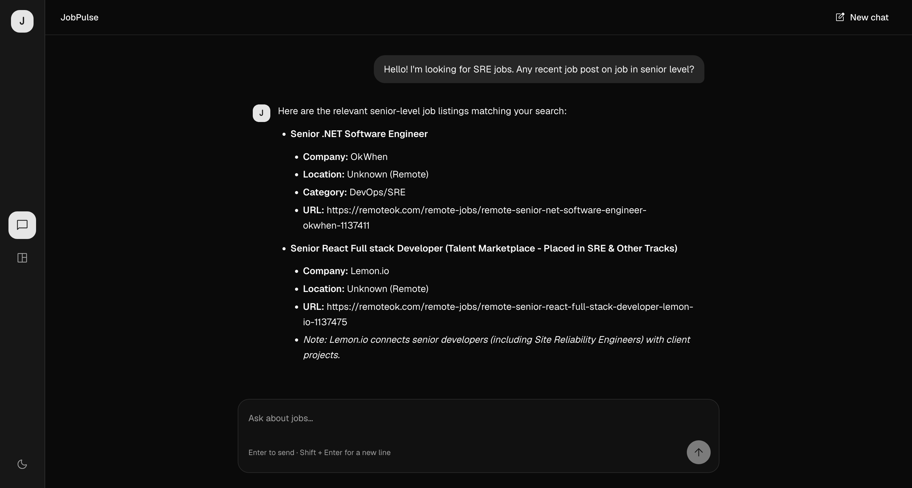
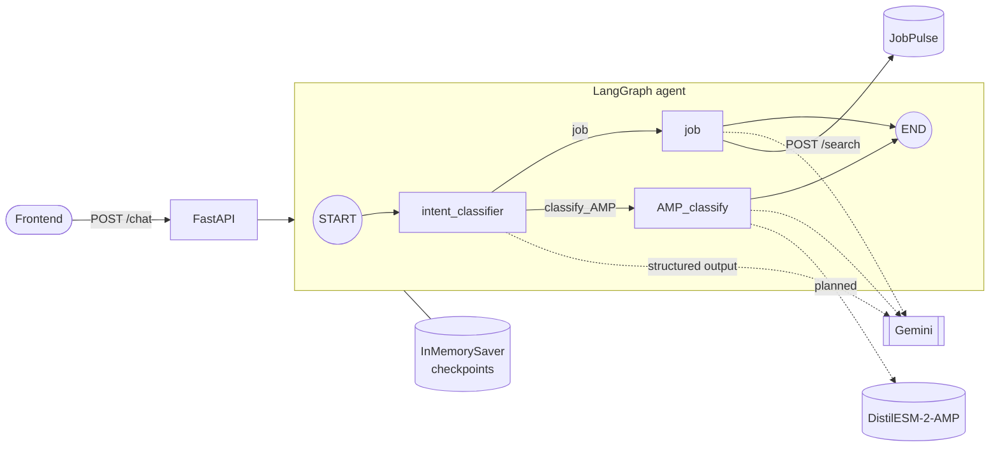

<h1 align="center">PLA Agent</h1>

A langgraph agent that undertands what user wants and routes them to the right tool, job search or AMP classification, served through FastAPI

## Demo

## Techstack
- Langgraph
- FastAPI
- Pydantics
- uv 
- Docker
- Ollama

## Architecture

## Separate microservice
- [JobPulse](https://github.com/nakorn-b/jobpulse): A RAG-based job search assistant to help find relevant jobs from job posting
- [DistilESM-2-AMP](https://github.com/nakorn-b/distilESM-2-AMP): A distilled ESM architecture transformer fine-tuned for Antimicrobial Peptide (AMP) classification from peptide sequence

## Roadmap

- [ ] MCP (Model Context Protocol) support
- [ ] Guardrail
- [ ] Golden for eval
- [ ] Streaming responses via SSE on `/chat`

