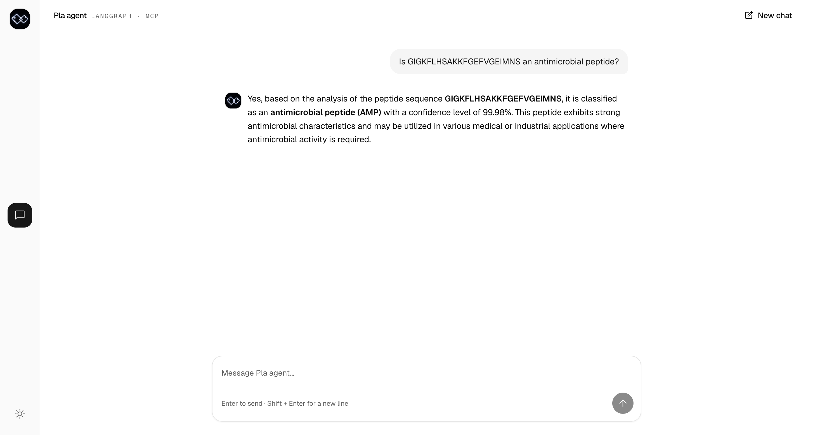
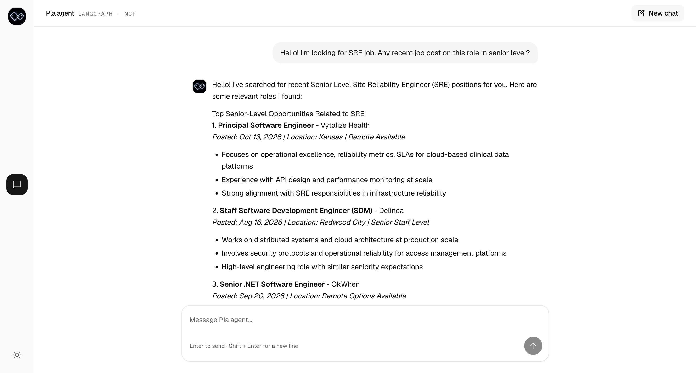
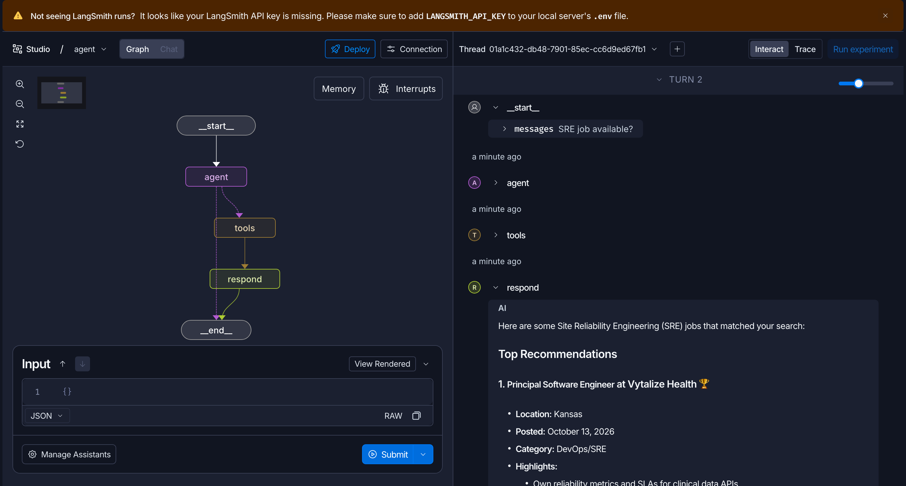
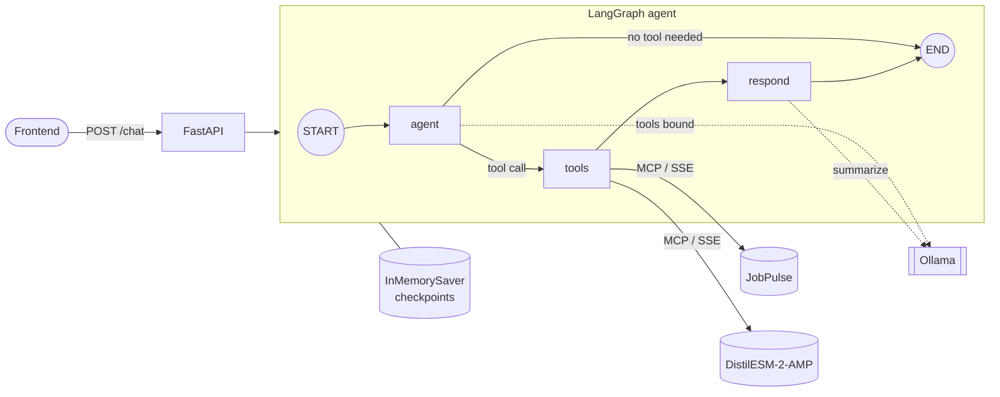

<h1 align="center">PLA Agent</h1>

<p align="center">
  <a href="CHANGELOG.md"></a>
  
</p>

A LangGraph agent that understands what the user wants and routes the request to the right tool, job search or antimicrobial peptide (AMP) classification. It is served through FastAPI, and its tools come from MCP servers.

> **v1.1.0:** the agent now calls JobPulse and DistilESM-2-AMP as MCP tools instead of using a fixed intent classifier. See the [changelog](CHANGELOG.md) for details.

## Demo





## Tracing



## Tech stack

- LangGraph
- FastAPI
- Pydantic
- MCP (Model Context Protocol)
- Ollama
- uv
- Docker

## Architecture



1. The `agent` node sends the conversation to the LLM with the MCP tools bound. The LLM either picks a tool or answers directly.
2. The `tools` node runs the chosen tool on the JobPulse or DistilESM-2-AMP MCP server.
3. The `respond` node calls the LLM again, without tools, to turn the tool's output into a reply.

Conversation memory is keyed by `thread_id`.

## Separate microservices (MCP tools)

- [JobPulse](https://github.com/nakorn-b/jobpulse): a RAG-based job search assistant that finds relevant jobs from job postings.
- [DistilESM-2-AMP](https://github.com/nakorn-b/distilESM-2-AMP): a distilled ESM transformer fine-tuned to classify antimicrobial peptides (AMPs) from their sequences.

Both MCP servers must be running before you start the agent, because it loads its tools at startup.

## Getting started

Requirements: [uv](https://docs.astral.sh/uv/), [Ollama](https://ollama.com/) with the model pulled (`ollama pull qwen3.5:4b`), and both MCP servers running.

```bash
uv sync
uv run fastapi dev src/app/api/main.py
```

Send a message:

```bash
curl -X POST localhost:8000/chat -H 'Content-Type: application/json' \
  -d '{"message": "find senior SRE jobs", "thread_id": "t1"}'
```

`thread_id` is optional. Reuse the same value to continue a conversation.

To open the graph in LangGraph Studio instead, run `uv run langgraph dev`.

## Configuration

Set these in `.env`:

| Variable | Default | Purpose |
| --- | --- | --- |
| `MODEL_NAME` | `qwen3.5:4b` | Ollama model |
| `OLLAMA_HOST` | `http://localhost:11434` | Ollama server |
| `JOBPULSE_MCP_URL` | `http://localhost:8001/sse` | JobPulse MCP server |
| `AMP_MCP_URL` | `http://localhost:8002/sse` | DistilESM-2-AMP MCP server |
| `CORS_ORIGINS` | `http://localhost:5173` | Allowed frontend origins, comma-separated |

## Roadmap

- [x] MCP (Model Context Protocol) support
- [x] Streaming responses via SSE on `/chat`
- [ ] Guardrails
- [ ] Golden set for evals
- [ ] ReAct loop
